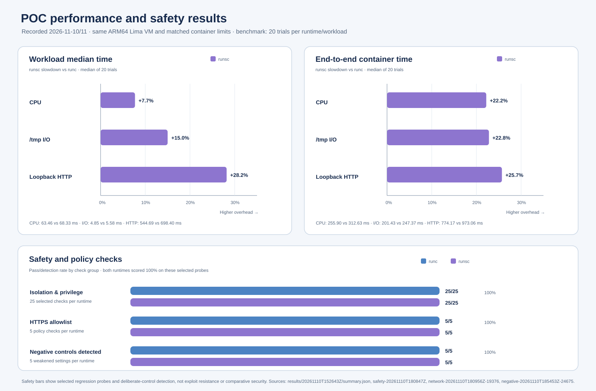

# Local gVisor POC summary

1. **Objective:** Compare Docker's default `runc` runtime with gVisor's `runsc` for synthetic performance, runtime compatibility, and selected sandbox policy checks. This POC is an engineering evaluation, not a security certification.
2. **Environment:** Apple Silicon Mac running a dedicated Lima ARM64 Ubuntu VM, Docker Engine 29.9.3, gVisor `release-20261102.0`, and a digest-pinned Python 3.12 image.
3. **Matched container policy:** Both runtime paths use the same image and limits: 1 CPU, 256 MiB RAM, 128 PIDs, non-root UID 10001, all capabilities dropped, `no_new_privileges`, read-only root filesystem, writable 64 MiB `/tmp`, and no network for baseline tests.
4. **Performance method:** The refined benchmark warmed up each runtime/workload pair, alternated runtime order, reversed workload order every other trial, and collected 20 measurements per pair. It reports workload duration and end-to-end `docker run` time.
5. **Performance finding:** In this VM and run, `runsc` median workload time was 7.7% slower for CPU, 15.0% slower for `/tmp` I/O, and 28.2% slower for 200 loopback HTTP requests. End-to-end medians were 22.2%, 22.8%, and 25.7% slower, respectively.
6. **Performance limits:** Results cover one VM, one benchmark run, and short synthetic workloads. `/tmp` is memory-backed; image pulls/builds are outside the timing. These measurements do not predict production performance or durable-storage behavior.
7. **Baseline isolation checks:** Both runtimes passed the reported 25 selected privilege and host-boundary checks. They verified non-root execution, zero effective capabilities, `no_new_privileges`, denied `setuid(0)`, read-only root, private process view, no visible Docker socket or synthetic guest marker, and no external network in the baseline case.
8. **Sudo interpretation:** The minimal image has no `sudo` binary; the workload also failed to gain root via `setuid(0)`. This verifies the configured probe case, not behavior with every possible `sudo` installation.
9. **HTTPS allowlist:** Both runtimes passed all five checks for the demonstration proxy path: allowed `example.com:443`, denied `example.org`, denied an IP-literal request, denied port 8443, and blocked direct workload egress. This validates the configured path, not a production proxy against hostile clients or proxy compromise.
10. **Negative controls:** Ten deliberately weakened cases were detected across both runtimes: root user, added capability, writable root filesystem, synthetic bind mount, and direct bridge egress. A discovered Docker inspect gap for `--mount` was fixed by checking both `HostConfig.Binds` and top-level `Mounts`.
11. **Syscall matrix:** Seven harmless probes were run with Docker's built-in seccomp profile and a hash-pinned derived overlay. Under `runc`, `bpf`, `keyctl`, and `mount` changed from generic `EPERM` to errors consistent with the deliberately invalid requests when allowed through the overlay. `runsc` returned the same outcomes under both profile modes.
12. **Syscall interpretation and verdict:** The errno differences are consistent with Docker seccomp affecting some `runc` calls, while `runsc` handles these probes differently or another unchanged control applies. They do not identify every enforcement layer and do not prove that `runsc` is more secure. The overall result is that both runtimes passed these selected configuration probes, with `runsc` slower on the measured synthetic workloads.
13. **Next steps:** Follow the threat model and prioritized test matrix in [SECURITY_VALIDATION_PLAN.md](SECURITY_VALIDATION_PLAN.md). Start with the P0 filesystem, egress, privilege, and negative-control cases; optionally collect the documented `runsc-trace` diagnostic in the idle, disposable Lima VM (Docker daemon configuration/restart required); then repeat benchmarks across multiple VM boots. Keep conclusions bounded to the tests actually run.

For a concise leadership brief, see [EXECUTIVE_SUMMARY.md](EXECUTIVE_SUMMARY.md). Detailed data, methods, and limitations are in [REPORT.md](REPORT.md). Setup and commands are in [README.md](README.md). The `runsc-trace` procedure has been documented but **has not yet been run**; no new trace evidence is included in the findings above.
