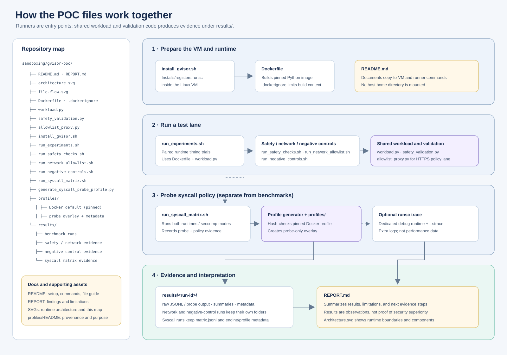
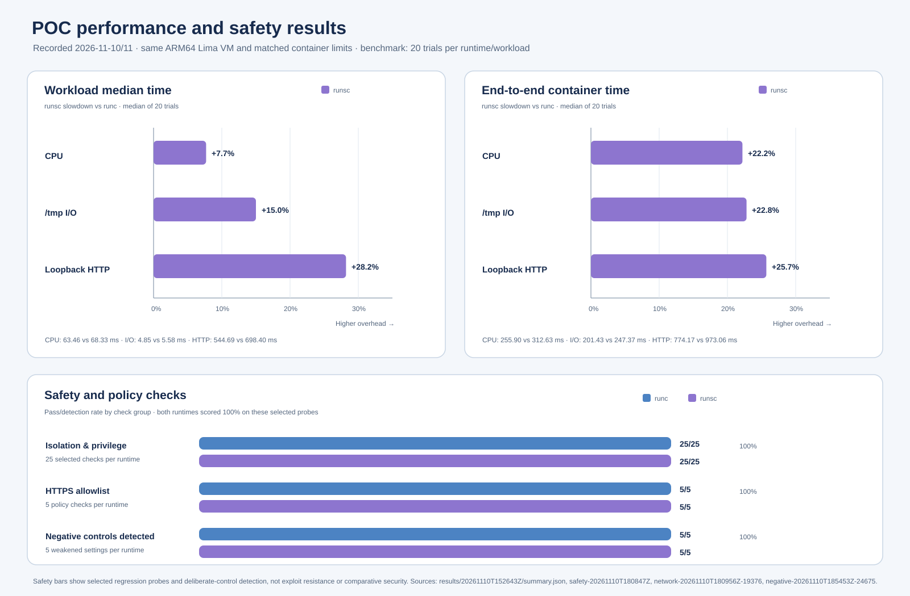

# Local gVisor POC

Compare Docker's default `runc` runtime with gVisor's `runsc` runtime on the same Lima Linux VM. This is a local engineering experiment, not a security certification.

See [POC_SUMMARY.md](POC_SUMMARY.md) for a 13-point overview of the design, findings, limitations, and next steps.






## Current setup

- Host: Apple Silicon macOS
- VM: Lima ARM64 Ubuntu, rootful Docker Engine
- Runtimes: Docker default (`runc`) and gVisor (`runsc`)
- Workloads: dependency-free Python CPU, temporary-file I/O, and loopback HTTP
- Limits: 1 CPU, 256 MiB memory, 128 PIDs, read-only root filesystem

The VM is dedicated to this POC and does not mount the host home directory. Workloads run as a non-root user with no-new-privileges. Benchmark and baseline safety containers use no network; the separate allowlist test gives the workload an internal-only network and a single explicit proxy path. The runner warms up each runtime/workload pair once, alternates runtime order by trial, and performs 20 measured trials per pair by default. It records workload time and end-to-end `docker run` wall time, plus environment metadata and raw samples. The Python base image is pinned by digest.

## Status

The host has Go 1.27.3, Lima 2.3.0, and Docker Desktop. The guest uses Ubuntu 26.04.1, kernel 7.0.0-38-generic, Docker Engine 29.9.3, and gVisor 20261102.0. Both runtimes passed the smoke checks, 25 selected privilege/host-boundary checks, and five HTTPS allowlist checks. Ten negative-control cases also detected the deliberately weakened settings under both runtimes. These are narrow configuration and policy probes, not a security assessment. The refined benchmark completed 20 trials per workload/runtime after warm-ups, alternating runtime order.

## Files

- `architecture.svg`: host, VM, runtime, workload, and results flow.
- `file-flow.svg`: repository file map and how the runners connect to code and evidence.
- `poc-metrics.svg`: benchmark slowdown and selected safety/policy check results.
- `Dockerfile`: creates the small Python workload image.
- `.dockerignore`: keeps local results and tools out of the image build context.
- `workload.py`: CPU, file I/O, and loopback HTTP synthetic workloads.
- `install_gvisor.sh`: adds the official gVisor apt repository and configures Docker inside Ubuntu.
- `run_experiments.sh`: warm-ups, alternating paired measurements, environment capture, and summary statistics. Set `POC_TRIALS` to change the default of 20.
- `run_safety_checks.sh`: checks filesystem visibility, Docker launch configuration, PID namespace, privilege restrictions, syscalls, loopback, and no-network behavior under both runtimes.
- `safety_validation.py`: shared Docker launch-config checks used by both regular and negative-control runs.
- `run_syscall_matrix.sh`: compares harmless syscall-probe outcomes under Docker's built-in seccomp profile and a narrow derived profile for both runtimes, and verifies a synthetic guest marker remains unchanged.
- `generate_syscall_probe_profile.py`, `profiles/`: derive the probe-only seccomp overlay from the exact Docker Engine 29.9.3 built-in profile with a SHA-256 check.
- `allowlist_proxy.py`, `run_network_allowlist.sh`: check exact-host HTTPS allowlisting with an internal-only workload network and a proxy that alone has external bridge egress.
- `run_negative_controls.sh`: deliberately weakens selected settings using only temporary containers and a synthetic marker, then confirms the probes detect root execution, an added capability, writable rootfs, a bind mount, and direct egress.

Create the VM with `limactl start --name=gvisor-poc --vm-type=vz --cpus=4 --memory=6 --disk=40 --mount-none template:docker-rootful`. From this repository's root, copy the project files into the guest:

```bash
limactl shell gvisor-poc -- mkdir -p /tmp/gvisor-poc
limactl copy -r .dockerignore Dockerfile README.md REPORT.md POC_SUMMARY.md architecture.svg file-flow.svg poc-metrics.svg install_gvisor.sh run_experiments.sh run_safety_checks.sh safety_validation.py run_network_allowlist.sh run_negative_controls.sh run_syscall_matrix.sh generate_syscall_probe_profile.py profiles workload.py allowlist_proxy.py gvisor-poc:/tmp/gvisor-poc/
limactl shell gvisor-poc -- sh -lc 'mkdir -p "$HOME/gvisor-poc" && cp -R /tmp/gvisor-poc/. "$HOME/gvisor-poc/"'
```

Then install gVisor and run the experiments inside the guest:

```bash
limactl shell gvisor-poc -- sh -lc 'cd "$HOME/gvisor-poc" && sudo bash install_gvisor.sh && bash run_experiments.sh'
limactl shell gvisor-poc -- sh -lc 'cd "$HOME/gvisor-poc" && bash run_safety_checks.sh'
limactl shell gvisor-poc -- sh -lc 'cd "$HOME/gvisor-poc" && bash run_network_allowlist.sh'
limactl shell gvisor-poc -- sh -lc 'cd "$HOME/gvisor-poc" && bash run_negative_controls.sh'
limactl shell gvisor-poc -- sh -lc 'cd "$HOME/gvisor-poc" && bash run_syscall_matrix.sh'
```

Results are written under the project directory regardless of the caller's working directory. Each run saves `environment.json`, `runtimes.json`, `warmup.jsonl`, `raw.jsonl`, and `summary.json` in a timestamped results directory.

Run the selected safety/compatibility probes from the same guest with `bash run_safety_checks.sh`. They use a temporary synthetic marker outside the container and remove it on exit. Their containers also drop all Linux capabilities; the runner inspects Docker's container configuration to verify no host bind mounts, devices, privileged mode, or host namespaces were requested. The probes check non-root execution, effective capabilities, `no_new_privs`, denied `setuid(0)`, sudo absence/non-escalation, and Docker socket invisibility.

Run the separate allowlist test with `bash run_network_allowlist.sh`. By default it permits HTTPS to `example.com`, denies `example.org`, IP literals, and non-443 ports, and checks that the workload cannot bypass the proxy with direct egress. Only the trusted test proxy joins the external bridge network. Override the demonstration allowlist with `POC_ALLOWED_HOSTS`, and update the probe targets to match. The example-domain run is a policy-path check, not a production egress proxy recommendation.

All checks are narrow regression probes, not an adversarial security assessment or proof of isolation.

For each runtime, the syscall matrix runs once with Docker's built-in seccomp profile and once with a derived probe profile. The latter is based on the Engine 29.9.3 profile and adds unconditional allow rules only for `bpf`, `keyctl`, `mount`, `perf_event_open`, `unshare`, and `userfaultfd`; capabilities remain dropped, and all arguments are invalid or any returned descriptor is closed immediately. The runner refuses to compare if the engine version or reported built-in seccomp profile does not match the pinned source. This derived profile is strictly for the isolated experiment, not a production profile. The matrix is observational: it records whether each probe was permitted, blocked, unsupported, rejected for its deliberately invalid arguments, or terminated. It does not test escape resistance.

### Optional gVisor syscall tracing

To collect gVisor's own syscall trace alongside a repeat of the matrix, register a separate debug runtime inside the disposable Lima VM. This changes Docker's daemon configuration and requires a Docker restart, which interrupts running containers. Do this only when the VM is idle and the restart is approved for your environment. Do not enable debug tracing on a production daemon. The official gVisor guide documents `--strace` and per-command debug log files: <https://gvisor.dev/docs/user_guide/debugging/>.

```bash
sudo mkdir -p /tmp/gvisor-poc-runsc-trace
sudo chmod 700 /tmp/gvisor-poc-runsc-trace
sudo runsc install --runtime runsc-trace -- \
  --debug \
  --debug-log=/tmp/gvisor-poc-runsc-trace/ \
  --strace
sudo systemctl restart docker
docker info --format '{{json .Runtimes}}'
POC_SYSCALL_RUNTIMES=runsc-trace \
POC_SYSCALL_OUTPUT=results/syscall-runsc-trace \
  bash run_syscall_matrix.sh
sudo cp -R /tmp/gvisor-poc-runsc-trace results/syscall-runsc-trace/runsc-trace-logs
```

The runner accepts a space-separated `POC_SYSCALL_RUNTIMES` list; its default remains `runc runsc`. Keep this tracing run separate from timing benchmarks: tracing adds overhead and captures extra syscall detail. gVisor's trace can show how `runsc` handles application syscalls, but it cannot identify the exact host-kernel seccomp decision for `runc`. Compare it with the probe JSON and existing Docker/profile metadata, and report conclusions as observed handling rather than proof of a security advantage. After collecting the logs, remove the temporary `runsc-trace` entry from Docker's daemon configuration and restart Docker again when the VM is idle. Keep the copied trace directory access restricted because syscall logs can contain workload arguments.

Do not compare results from Docker Desktop with results from the Lima VM. The experiment measures synthetic compatibility and speed only; it does not establish a security guarantee.
