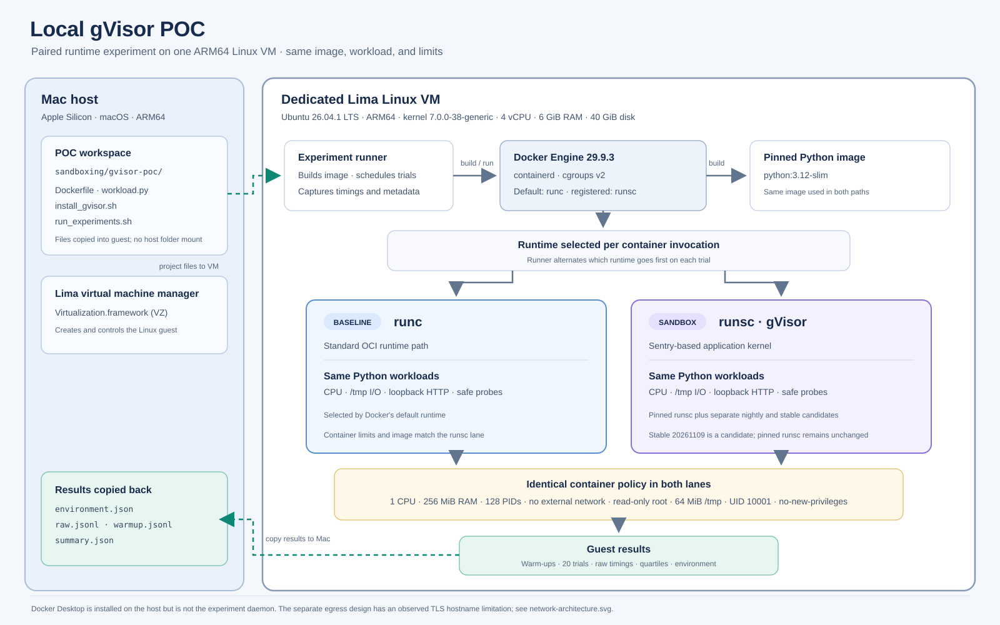
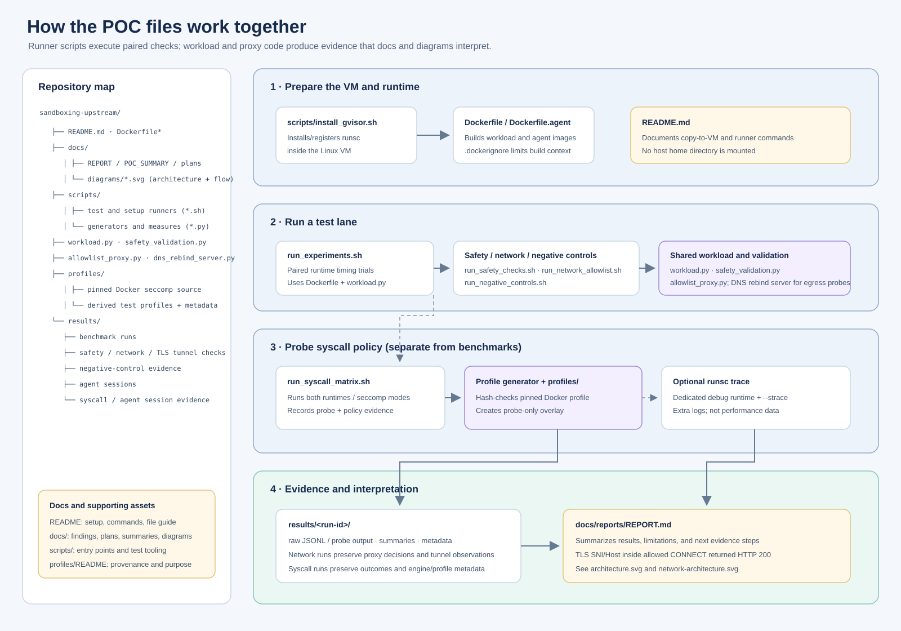

# Local gVisor POC

Compare Docker's default `runc` runtime with gVisor's `runsc` runtime on the same Lima Linux VM. This is a local engineering experiment, not a security certification.

See [the POC summary](docs/POC_SUMMARY.md) for a 13-point overview of the design, findings, limitations, and next steps.
The whiteboard functional and non-functional requirements, evidence, and remaining work are tracked in the [requirements status matrix](docs/REQUIREMENTS_STATUS.md).
For a concise shareable brief, see the [executive summary](docs/EXECUTIVE_SUMMARY.md).
The [session console UI prototype](docs/UI_PROTOTYPE.md) shows the proposed operator workflow; its session rows and actions are simulated.
The detailed threat model, prioritized security test matrix, and evidence criteria are in the [security validation plan](docs/SECURITY_VALIDATION_PLAN.md).
The real Claude Code and Codex CLI validation matrix, initial results, and remaining cases are in the [agent validation plan](docs/AGENT_SESSION_VALIDATION_PLAN.md).
The proposed session API, lifecycle, policy boundary, and MVP acceptance criteria are in the [session control-plane spec](docs/SESSION_CONTROL_PLANE_SPEC.md).







## Current setup

- Host: Apple Silicon macOS
- VM: Lima ARM64 Ubuntu, rootful Docker Engine
- Pinned runtimes: Docker default (`runc`) and gVisor (`runsc`); separate newer candidates are `runsc-next` (nightly) and `runsc-stable-20261109` (latest stable release)
- Workloads: dependency-free Python CPU, temporary-file I/O, fresh and persistent loopback HTTP, TCP_NODELAY controls, and concurrent HTTP
- Limits: 1 CPU, 256 MiB memory, 128 PIDs, read-only root filesystem

The VM is dedicated to this POC and does not mount the host home directory. Workloads run as a non-root user with no-new-privileges. Benchmark and baseline safety containers use no network; the separate allowlist test gives the workload an internal-only network and a single explicit proxy path. The runner warms up each runtime/workload pair once, alternates runtime order by trial, and performs 20 measured trials per pair by default. It records workload time and end-to-end `docker run` wall time, plus environment metadata and raw samples. The Python base image is pinned by digest.

## Repository layout

```text
docs/       reports, validation plans, summaries, and diagrams
profiles/   pinned Docker seccomp source and derived test profiles
results/    benchmark, safety, network, and agent-session evidence
scripts/    VM setup, test runners, profile generators, and measurement tools
Dockerfile* image definitions; shared workload, proxy, DNS, and validation modules stay at the root
```

Run scripts from any directory; each runner locates the repository root before reading or writing project files. Set `POC_RUNTIMES=runsc-next` or `POC_RUNTIMES=runsc-stable-20261109` to target a candidate in the agent boundary/isolation, provider proxy, safety, allowlist, DNS-rebinding, and syscall-compatibility runners; their default remains `runc runsc`.

## Status

The host has Go 1.27.3, Lima 2.3.0, and Docker Desktop. The guest uses Ubuntu 26.04.1, kernel 7.0.0-38-generic, Docker Engine 29.9.3, and pinned gVisor `release-20261102.0`, with a separate stable `release-20261109.0` candidate. Existing baseline results include 25 selected privilege/host-boundary checks and ten detected negative controls. The expanded network parser suite passed 24 checks per runtime, but a separate TLS tunnel observation showed that a CONNECT authorized for `example.com:443` can carry SNI and HTTP Host `example.org` and receive HTTP 200. The proxy therefore does not enforce strict hostname allowlisting inside encrypted tunnels. The expanded syscall smoke passed nine selected calls under `runc` and stable gVisor. These are targeted configuration and compatibility probes, not a security assessment. The baseline synthetic workloads have archived 20-trial results; a fresh-connection/keep-alive comparison ran 50 trials, followed by 20-trial TCP_NODELAY and concurrent controls. The default-TCP keep-alive difference largely disappears with TCP_NODELAY enabled on both ends.

The first real-agent compatibility sample installed Claude Code 2.1.322 and Codex CLI 0.167.1 in a pinned ARM64 test image. Version/help startup and selected non-root, filesystem, no-network, child-process, worker-thread, and cross-session smoke checks passed under both runtimes. Fifty cached-image `--version` starts per CLI/runtime measured 84/107 ms p50/p95 for Claude under runc and 93/110 ms under runsc; Codex measured 99/120 ms under runc and 114/125 ms under runsc. These timings do not measure interactive readiness, model latency, or a full agent task. See the validation plan and raw trial file for limits and details.

Provider proxy CONNECT checks have since passed for the documented Claude and Codex authentication/API hosts under both runtimes. Direct client egress, client DNS, unapproved proxy targets, and alternate ports were blocked. These checks did not perform TLS or make a model request; see `results/agent-proxy-20261111/`.

The same authenticated Codex CLI prompt has now completed under both `runc` and `runsc` through the proxy with the read-only policy. Both returned the expected response; the proxy denied unlisted `oaiusercontent.com` and `ab.chatgpt.com` hosts without affecting either request. This is a functional comparison, not a latency result. The test logins were revoked and temporary containers/networks removed. See `results/agent-session-20261111/authenticated-smokes.json`.

A follow-up Codex-directed workspace task failed before making changes under both runtimes: bundled bubblewrap could not initialize its nested namespace (`RTM_NEWADDR` under runsc; namespace clone permission error under runc). This is a nested-sandbox compatibility blocker, not evidence of a runtime security difference. See `results/agent-session-20261111/workspace-tool-pair.json` and the validation plan.

The user subsequently confirmed both prior Codex logins were revoked and the temporary session/proxy containers and memory-backed homes were removed. `Dockerfile.agent` now installs Debian's `bubblewrap` package. Follow-up tracing found and corrected an ARM64 architecture-name bug in the POC seccomp generator; the corrected profile permits the namespace clone, but the pinned `runsc` and `runc` checks showed Bubblewrap compatibility failures (the Linux kernel rejected a nested `/proc` mount under the tested configuration). A temporary guest-only AppArmor profile was unloaded after each probe; no global sysctl or persistent AppArmor policy was changed. An outer-container-only Codex workspace smoke passed under both runc and runsc using `--no-daemon --sandbox danger-full-access --ask-for-approval on-request`; both agents created, verified, and deleted the temporary workspace file. In the runsc exec report, effective approval was `never`, so this mode relied on the outer container boundary and did not pause for approvals. A SHA-512-verified official gVisor ARM64 nightly from 2026-11-11 was registered as the separate Docker runtime `runsc-next`. The exact Bubblewrap nested-user/PID/network-namespace command that failed under the pinned `runsc` passed under `runsc-next`; this confirms that the newer build resolves this specific compatibility blocker. Stable `20261109.0` now includes the Bubblewrap loopback fix; it is installed and registered as `runsc-stable-20261109` alongside the unchanged pinned runtime. Its focused regression results are summarized in `results/agent-session-20261112/stable-20261109/regression-summary.json`. Boundary, cross-session, and provider-proxy regression checks also passed under `runsc-next`; the filesystem suite passed 29 checks, the general allowlist passed 16 checks, DNS rebinding was blocked, and both common-syscall checks passed. Summary and raw logs are under `results/agent-session-20261112/runsc-next-*`; the nightly `runsc-next` remains unpromoted. Its checks are not a security or performance comparison. The official fix landed after the POC's pinned `release-20261102.0` (see [gVisor PR #17165](https://github.com/google/gvisor/pull/17165)). The stable `20261109.0` candidate subsequently passed the exact Bubblewrap smoke, 29 filesystem checks, 16 exact-host allowlist checks, provider proxy and DNS-rebinding checks, common syscall and matrix checks, focused namespace/mount probes, and focused ptrace checks. The authenticated Codex workspace-write smoke under this runtime also passed: Codex created, read, and deleted a workspace marker, while an outside-workspace write was denied and a direct outer-container control confirmed that path writable. Full findings and limitations are in `results/agent-session-20261112/stable-20261109/regression-summary.json` and `docs/AGENT_SESSION_VALIDATION_PLAN.md`.

The authenticated Codex CLI `workspace-write` smoke then succeeded under `runsc-next`: it created, read back, and deleted a workspace-only marker. The container ran as UID 10001, with a read-only root filesystem, all capabilities dropped, no host mounts, and `no_new_privileges`. A follow-up using `--approve-for-me` reported `approval=on-request` and `sandbox=workspace-write`: writing in `/workspace` succeeded, while writing to a user-writable `/home/agent` path outside the workspace was denied. A direct container control showed `/home/agent` itself was writable, isolating the denial to Codex's workspace sandbox. A separate interactive TTY run with `--ask-for-approval on-request` displayed a prompt for the same outside-workspace write; I denied it with Escape, and the marker remained absent. Evidence: `results/agent-session-20261112/runsc-next-codex-workspace-smoke.json`, `results/agent-session-20261112/runsc-next-codex-approval-boundary.json`, and `results/agent-session-20261112/runsc-next-codex-interactive-approval.json`. See `profiles/README.md`, `results/agent-session-20261111/workspace-tool-pair.json`, both `results/agent-session-20261112/outer-container-only-*.json` records, and the [validation plan](docs/AGENT_SESSION_VALIDATION_PLAN.md).

## Files

- `docs/UI_PROTOTYPE.md`, `ui/prototype/`: local static dashboard prototype and how to run it.
- `docs/diagrams/architecture.svg`: host, VM, runtime, workload, and results flow.
- `docs/diagrams/network-architecture.svg`: internal workload network, egress proxy, TLS tunnel behavior, and the hostname policy gap found in testing.
- `docs/diagrams/file-flow.svg`: repository file map and how the runners connect to code and evidence.
- `docs/diagrams/poc-metrics.svg`: benchmark slowdown and selected safety/policy check results.
- `docs/EXECUTIVE_SUMMARY.md`: concise POC outcome, evidence, and recommendation for executive review.
- `docs/SECURITY_VALIDATION_PLAN.md`: threat model, prioritized security tests, pass criteria, and evidence template.
- `docs/AGENT_SESSION_VALIDATION_PLAN.md`: real Claude Code/Codex CLI compatibility matrix, results, and remaining cases.
- `docs/PLATFORM_ROADMAP.md`: proposed milestones for an organization-managed agent-session platform.
- `docs/WARDYN_FIT_ASSESSMENT.md`: source-level Wardyn fit review and the live checks still required.
- `docs/REPORT.md`, `docs/POC_SUMMARY.md`: detailed findings and a 13-point project overview.
- `Dockerfile.agent`: pinned, non-root test image with Claude Code and Codex CLI; contains no credentials.
- `scripts/measure_agent_startup.py`: 50-trial cached-image CLI process-start measurement for each CLI/runtime pair.
- `scripts/run_agent_boundary_smoke.sh`, `scripts/run_agent_isolation_smoke.sh`: synthetic privilege, filesystem, network-off, cross-session, and cleanup probes.
- `scripts/run_agent_provider_proxy_probe.sh`: checks provider-domain CONNECT allowlisting, blocked direct egress/DNS, and denied targets.
- `scripts/run_agent_model_smoke.sh`: starts a temporary proxy and isolated CLI container for a manual authenticated smoke request under `runc`, `runsc`, or the separately registered `runsc-next`. CLI home/workspace data use memory-backed filesystems.
- `scripts/generate_bwrap_seccomp_profile.py`: derives a test-only, namespace-limited seccomp profile from the pinned Docker default for the nested bubblewrap probe.
- `results/agent-session-20261111/workspace-tool-pair.json`: paired result for Codex's first authenticated workspace and shell task.
- `Dockerfile`: creates the small Python workload image.
- `.dockerignore`: keeps local results and tools out of the image build context.
- `workload.py`: CPU, file I/O, loopback HTTP, filesystem/process boundary, network allowlist, and syscall diagnostic probes.
- `scripts/install_gvisor.sh`: adds the official gVisor apt repository and configures Docker inside Ubuntu.
- `scripts/run_experiments.sh`: warm-ups, alternating paired measurements, environment capture, and summary statistics. Set `POC_TRIALS` to change the default of 20 or `POC_WORKLOADS` to choose a space-separated workload subset.
- `scripts/run_safety_checks.sh`: checks filesystem visibility, Docker launch configuration, PID namespace, privilege restrictions, syscalls, loopback, and no-network behavior under both runtimes.
- `safety_validation.py`: shared Docker launch-config checks used by both regular and negative-control runs.
- `scripts/run_syscall_matrix.sh`: compares harmless syscall-probe outcomes under Docker's built-in seccomp profile and a narrow derived profile for both runtimes, and verifies a synthetic guest marker remains unchanged.
- `scripts/generate_syscall_probe_profile.py`, `scripts/generate_bwrap_seccomp_profile.py`, `profiles/`: derive probe-only seccomp profiles from the exact Docker Engine 29.9.3 built-in profile with a SHA-256 check.
- `allowlist_proxy.py`, `scripts/run_network_allowlist.sh`: check exact-host HTTPS allowlisting with an internal-only workload network and a proxy that alone has external bridge egress.
- `scripts/run_negative_controls.sh`: deliberately weakens selected settings using only temporary containers and a synthetic marker, then confirms the probes detect root execution, an added capability, writable rootfs, a bind mount, and direct egress.
- `scripts/run_launch_policy_negative_controls.sh`: creates and inspects privileged, host-namespace, device, and writable-bind configurations without starting those containers.
- `dns_rebind_server.py`, `scripts/run_dns_rebinding_smoke.sh`: use a synthetic DNS server to test proxy handling of an allowlisted hostname that changes from a public IP to loopback.
- `scripts/run_syscall_compatibility_smoke.sh`: checks selected everyday file, memory, event, polling, socket, process, and thread APIs under both runtimes.

Create the VM with `limactl start --name=gvisor-poc --vm-type=vz --cpus=4 --memory=6 --disk=40 --mount-none template:docker-rootful`. From this repository's root, copy the project files into the guest:

```bash
limactl shell gvisor-poc -- mkdir -p /tmp/gvisor-poc
limactl copy -r .dockerignore Dockerfile Dockerfile.agent README.md docs scripts profiles workload.py safety_validation.py allowlist_proxy.py dns_rebind_server.py gvisor-poc:/tmp/gvisor-poc/
limactl shell gvisor-poc -- sh -lc 'mkdir -p "$HOME/gvisor-poc" && cp -R /tmp/gvisor-poc/. "$HOME/gvisor-poc/"'
```

Then install gVisor and run the experiments inside the guest:

```bash
limactl shell gvisor-poc -- sh -lc 'cd "$HOME/gvisor-poc" && sudo bash scripts/install_gvisor.sh && bash scripts/run_experiments.sh'
limactl shell gvisor-poc -- sh -lc 'cd "$HOME/gvisor-poc" && bash scripts/run_safety_checks.sh'
limactl shell gvisor-poc -- sh -lc 'cd "$HOME/gvisor-poc" && bash scripts/run_network_allowlist.sh'
limactl shell gvisor-poc -- sh -lc 'cd "$HOME/gvisor-poc" && bash scripts/run_negative_controls.sh'
limactl shell gvisor-poc -- sh -lc 'cd "$HOME/gvisor-poc" && bash scripts/run_launch_policy_negative_controls.sh'
limactl shell gvisor-poc -- sh -lc 'cd "$HOME/gvisor-poc" && bash scripts/run_dns_rebinding_smoke.sh'
limactl shell gvisor-poc -- sh -lc 'cd "$HOME/gvisor-poc" && bash scripts/run_syscall_compatibility_smoke.sh'
limactl shell gvisor-poc -- sh -lc 'cd "$HOME/gvisor-poc" && bash scripts/run_syscall_matrix.sh'
```

Build and smoke the agent image inside the Linux guest (the first build downloads the pinned CLI packages):

```bash
docker build -f Dockerfile.agent -t local/agent-session:claude-2.1.322-codex-0.167.1 .
bash scripts/run_agent_boundary_smoke.sh
bash scripts/run_agent_isolation_smoke.sh
python3 scripts/measure_agent_startup.py --trials 50 --output results/agent-session-$(date -u +%Y%m%d)/startup.json
```

The interactive/model, credential, Git, and allowlist-proxy cases need a separate disposable test account and remain outstanding. Do not copy personal CLI login state or production credentials into the image.

Results are written under the project directory regardless of the caller's working directory. Each run saves `environment.json`, `runtimes.json`, `warmup.jsonl`, `raw.jsonl`, and `summary.json` in a timestamped results directory.

The HTTP benchmark includes fresh connections, serial keep-alive, serial keep-alive with `TCP_NODELAY` on both ends, and eight concurrent keep-alive connections with and without `TCP_NODELAY`. Each case sends 200 tiny loopback requests. Run a focused diagnostic with `POC_TRIALS=20 POC_WORKLOADS="http-keepalive http-keepalive-nodelay http-concurrent-keepalive http-concurrent-keepalive-nodelay" bash scripts/run_experiments.sh` inside the Lima VM. The full default set runs all workloads. The measured default-TCP keep-alive gap largely disappears with `TCP_NODELAY`; see the follow-up results and interpretation in [the report](docs/REPORT.md). The fresh-connection case uses explicit HTTP/1.1 close semantics, so compare it with the other new HTTP/1.1 cases rather than treating it as an exact rerun of the archived HTTP/1.0 baseline. Repeat representative tests across fresh VM boots before making broader performance claims.

Run the selected safety/compatibility probes from the same guest with `bash scripts/run_safety_checks.sh`. They use a temporary synthetic marker outside the container and remove it on exit. Their containers also drop all Linux capabilities; the runner inspects Docker's container configuration to verify no host bind mounts, devices, privileged mode, or host namespaces were requested. The probes check non-root execution, effective capabilities, `no_new_privs`, denied `setuid(0)`, sudo absence/non-escalation, and Docker socket invisibility.

Run the separate allowlist test with `bash scripts/run_network_allowlist.sh`. By default it permits CONNECT to `example.com:443`, denies `example.org`, IP literals, and non-443 ports, and checks raw proxy authority handling plus direct TCP/UDP egress. Only the trusted test proxy joins the external bridge network. The proxy does not inspect encrypted TLS SNI/HTTP Host: the expanded test demonstrated that traffic for `example.org` can be carried through a CONNECT to `example.com:443`. Do not use this design to claim strict domain isolation; use a TLS-aware gateway or equivalent network enforcement and repeat the bypass tests. Override the demonstration allowlist with `POC_ALLOWED_HOSTS`, and update the probe targets to match.

To additionally exercise a public HTTPS redirect from an allowed host to a denied host, run `POC_ALLOWED_HOSTS=example.com,httpbin.org POC_REDIRECT_TEST_URL='https://httpbin.org/redirect-to?url=https%3A%2F%2Fexample.org%2F&status_code=302' bash scripts/run_network_allowlist.sh`. This optional check relies on the public redirect service being available.

All checks are narrow regression probes, not an adversarial security assessment or proof of isolation.

For each runtime, the syscall matrix runs once with Docker's built-in seccomp profile and once with a derived probe profile. The latter is based on the Engine 29.9.3 profile and adds unconditional allow rules only for `bpf`, `keyctl`, `mount`, `perf_event_open`, `unshare`, and `userfaultfd`; capabilities remain dropped, and all arguments are invalid or any returned descriptor is closed immediately. The runner refuses to compare if the engine version or reported built-in seccomp profile does not match the pinned source. This derived profile is strictly for the isolated experiment, not a production profile. The matrix is observational: it records whether each probe was permitted, blocked, unsupported, rejected for its deliberately invalid arguments, or terminated. It does not test escape resistance.

### Authenticated agent smoke request

`scripts/run_agent_model_smoke.sh` starts a per-session CLI container with an ephemeral home directory, a synthetic writable workspace, the internal-only client network, and the exact-host proxy. It mounts no host files or credentials. From macOS Terminal, attach to a prepared container:

```bash
limactl shell gvisor-poc -- docker exec -it agent-session-runsc-claude /bin/bash
# or
limactl shell gvisor-poc -- docker exec -it agent-session-runsc-codex /bin/bash
# Newer nightly runtime, after it has been installed and registered:
limactl shell gvisor-poc -- docker exec -it agent-session-runsc-next-codex /bin/bash
```

Inside the Claude container, run `claude` and complete sign-in in your browser. Start the chosen runtime with `bash scripts/run_agent_model_smoke.sh start runsc-next codex` inside the VM (or use `runsc`/`runc` for the pinned comparisons). Inside the Codex container, run `codex login --device-auth` and complete the device sign-in. Leave the container running after authentication and tell the operator it is ready; then run one fixed harmless prompt and log out. Stop the temporary containers and proxy with `limactl shell gvisor-poc -- bash -lc 'cd "$HOME/gvisor-poc" && bash scripts/run_agent_model_smoke.sh stop'`. Removing the containers deletes their memory-backed homes. Never paste credentials or login codes into chat or save them in the image.

### Optional gVisor syscall tracing

To collect gVisor's own syscall trace alongside a repeat of the matrix, register a separate debug runtime inside the disposable Lima VM. This changes Docker's daemon configuration and requires a Docker restart, which interrupts running containers. Do this only when the VM is idle and the restart is approved for your environment. Do not enable debug tracing on a production daemon. The official gVisor guide documents `--strace` and per-command debug log files: <https://gvisor.dev/docs/user_guide/debugging/>.

```bash
sudo mkdir -p /tmp/gvisor-poc-runsc-trace
sudo chmod 700 /tmp/gvisor-poc-runsc-trace
sudo runsc install --runtime runsc-trace -- \
  --debug \
  --debug-log=/tmp/gvisor-poc-runsc-trace/ \
  --strace
sudo systemctl restart docker
docker info --format '{{json .Runtimes}}'
POC_SYSCALL_RUNTIMES=runsc-trace \
POC_SYSCALL_OUTPUT=results/syscall-runsc-trace \
  bash scripts/run_syscall_matrix.sh
sudo cp -R /tmp/gvisor-poc-runsc-trace results/syscall-runsc-trace/runsc-trace-logs
```

The runner accepts a space-separated `POC_SYSCALL_RUNTIMES` list; its default remains `runc runsc`. Keep this tracing run separate from timing benchmarks: tracing adds overhead and captures extra syscall detail. gVisor's trace can show how `runsc` handles application syscalls, but it cannot identify the exact host-kernel seccomp decision for `runc`. Compare it with the probe JSON and existing Docker/profile metadata, and report conclusions as observed handling rather than proof of a security advantage. After collecting the logs, remove the temporary `runsc-trace` entry from Docker's daemon configuration and restart Docker again when the VM is idle. Keep the copied trace directory access restricted because syscall logs can contain workload arguments.

Do not compare results from Docker Desktop with results from the Lima VM. The experiment measures synthetic compatibility and speed only; it does not establish a security guarantee.
