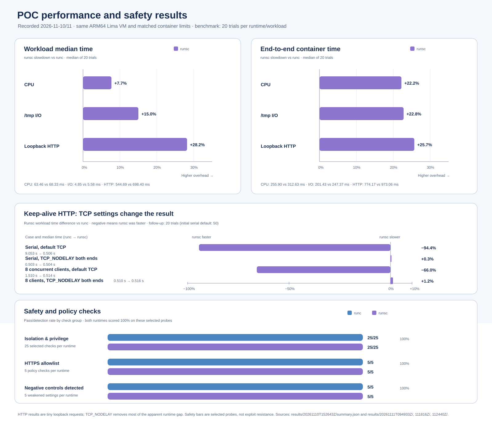

# Initial experiment report

> Requirement-level coverage, including concurrency, session-ready latency, uptime, prompt-injection controls, and dashboard/telemetry status, is tracked in the [requirements status matrix](REQUIREMENTS_STATUS.md). This report's benchmark timings are not session-ready latency or uptime measurements.

> **Current security note (2026-11-12):** The historical allowlist results below describe earlier checks and do not establish strict hostname isolation. The expanded tunnel probe later accepted TLS SNI/HTTP Host `example.org` through CONNECT to `example.com:443`, returning HTTP 200 under both `runc` and stable gVisor. See [the current POC summary](POC_SUMMARY.md), [network architecture diagram](diagrams/network-architecture.svg), and [raw results](../results/agent-session-20261112/stable-20261109/20261112-stable-20261109-network-expanded/).

Date: 2026-11-10 (UTC)

## Environment

- Lima 2.3.0 on an Apple Silicon Mac
- Ubuntu 26.04.1 LTS, ARM64, kernel 7.0.0-38-generic
- Docker Engine 29.9.3
- `runsc` release-20261102.0
- Python 3.12.16, pinned `python:3.12-slim` image digest
- 1 CPU, 256 MiB memory, 128 PID limit; no network; read-only image root; `/tmp` tmpfs; non-root user
- Three trials per workload/runtime, with `runc` trials run before `runsc` trials

## Run 1: exploratory three-trial run

| Workload | `runc` median | `runsc` median | `runsc` difference |
| --- | ---: | ---: | ---: |
| CPU: 300,000 SHA-256 iterations | 61.72 ms | 69.38 ms | +12.4% |
| I/O: write/read 8 MiB in `/tmp` | 5.32 ms | 5.87 ms | +10.3% |
| HTTP: 200 serial loopback requests | 546.51 ms | 703.13 ms | +28.7% |

Raw samples and medians are in `../results/20261110T151337Z/`. This run used a fixed runtime order and no warm-up; the following run supersedes it for performance interpretation.

## Run 2: warmed, alternating 20-trial run

The revised runner performs one warm-up for each runtime/workload pair, alternates which runtime runs first on each trial, reverses workload order every other trial, and captures both workload time and total `docker run` wall time. Each workload/runtime pair has 20 measured samples. Environment details are saved in `../results/20261110T152643Z/environment.json`, raw measurements in `raw.jsonl`, and quartiles/medians in `summary.json`.

### Workload time

| Workload | `runc` median (p25–p75) | `runsc` median (p25–p75) | `runsc` median difference |
| --- | ---: | ---: | ---: |
| CPU | 63.46 ms (62.74–64.19) | 68.33 ms (66.53–71.09) | +7.7% |
| I/O to `/tmp` | 4.85 ms (4.72–4.93) | 5.58 ms (5.51–5.68) | +15.0% |
| 200 loopback HTTP requests | 544.69 ms (543.62–546.69) | 698.40 ms (668.83–710.80) | +28.2% |

### End-to-end `docker run` wall time

| Workload | `runc` median | `runsc` median | `runsc` median difference |
| --- | ---: | ---: | ---: |
| CPU | 255.90 ms | 312.63 ms | +22.2% |
| I/O | 201.43 ms | 247.37 ms | +22.8% |
| HTTP | 774.17 ms | 973.06 ms | +25.7% |

In this VM and workload set, `runsc` was slower on all three workload timers and all three end-to-end timers. The P25–P75 ranges do not overlap for these samples, but this remains one machine and one run; it is not a general performance claim.

## Interpretation and limits

Both runtimes completed all workloads in the same ARM64 Ubuntu Lima VM with matched Docker limits. The second run reduces order bias and captures container start/stop overhead, but the workloads are synthetic and only 20 trials were collected. The I/O case uses a memory-backed `/tmp`, so it says nothing about durable storage performance. `container_wall_seconds` includes Docker container create/start/stop, but excludes image build and pull because the image is built before the measurements. These results do not measure exploit resistance or establish a security conclusion.

For a stronger performance comparison, repeat this protocol across multiple VM boots and increase workload duration to reduce timer overhead. For security evaluation, define a threat model and test specific isolation properties independently of these timings.

### Keep-alive and TCP follow-up

The follow-up added 200 serial HTTP/1.1 loopback requests on one persistent connection, the same case with `TCP_NODELAY` enabled on both client and server, and eight concurrent clients with 25 requests each. The runner alternated runtime and workload order. The first comparison collected 50 trials per runtime; TCP-setting and concurrency controls collected 20 trials per runtime. All used the same image, 1 CPU, 256 MiB memory, `--network=none`, and other baseline container limits. The results are in `../results/20261111T094933Z/summary.json`, `../results/20261111T111816Z/summary.json`, and `../results/20261111T112440Z/summary.json`.

| HTTP case | Trials | `runc` workload median | `runsc` workload median | `runsc` difference | `runc` container wall | `runsc` container wall |
| --- | ---: | ---: | ---: | ---: | ---: | ---: |
| 200 serial requests, default TCP | 50 + 20 repeat | 9,050 ms | 506 ms | −94.4% | 9,323 ms | 844 ms |
| 200 serial requests, `TCP_NODELAY` both ends | 20 | 503 ms | 504 ms | +0.3% | 787 ms | 841 ms |
| 8 concurrent connections, default TCP | 20 + 20 repeat | 1,510 ms | 514 ms | −66.0% | 1,787 ms | 863 ms |
| 8 concurrent connections, `TCP_NODELAY` both ends | 20 | 510 ms | 516 ms | +1.2% | 787 ms | 854 ms |

The large `runsc` advantage in the default-TCP cases disappears when `TCP_NODELAY` is enabled at both endpoints: the measured workload times are then within about 1.2%. This strongly implicates small-packet TCP behavior, such as Nagle/delayed-ACK interaction, in this loopback microbenchmark; the result is not evidence of generally faster gVisor networking. The concurrent case repeats the same pattern, and both default-TCP cases were stable across separate runs. A packet-level trace would be needed to attribute the mechanism more precisely.

These workloads send tiny responses over loopback inside a single `--network=none` container; they do not measure external egress, realistic application payloads, or production HTTP throughput. The earlier fresh-connection case also uses explicit HTTP/1.1 close semantics, so it is not an exact rerun of the archived HTTP/1.0 benchmark. Treat this as evidence that protocol and socket settings can dominate a runtime comparison. Repeat representative application-shaped network tests across VM boots before making performance claims.

## Safe isolation and compatibility probes

Date: 2026-11-10. The same probe image ran under both runtimes with 1 CPU, 256 MiB RAM, 128 PIDs, `--network=none`, read-only root, 64 MiB `/tmp`, UID 10001, `no-new-privileges`, and all Linux capabilities dropped. All 11 checks passed under both `runc` and `runsc`.

| Area | Probe | `runc` | `runsc` |
| --- | --- | --- | --- |
| Process | Workload is PID 1; `/proc` exposes only PID 1 | Pass | Pass |
| Identity | Workload runs as non-root UID 10001 | Pass | Pass |
| Guest filesystem visibility | Synthetic marker in guest home is not visible in container | Pass | Pass |
| Root filesystem | Write to image path is denied with `EROFS` | Pass | Pass |
| Temporary filesystem | Write under `/tmp` succeeds | Pass | Pass |
| Procfs and syscalls | Read `/proc/1/status`, `getrandom`, anonymous `mmap`, thread create/join | Pass | Pass |
| Networking | Loopback socket works; external connection to a documentation-only address is blocked | Pass | Pass |

Raw probe output is in `../results/safety-20261110T155834Z/checks.jsonl`. These are configuration regression checks for one benign process. They do not attempt container escapes, kernel exploitation, or malicious workloads, and they do not establish that either runtime is secure.

## Expanded boundary and egress policy checks

Date: 2026-11-10. Follow-up checks used the same guest, pinned workload image, and runtime limits. The safety runner inspected Docker's saved launch configuration as well as the process's observed state. Both `runc` and `runsc` passed all 25 checks; evidence is in `../results/safety-20261110T180847Z/checks.jsonl`.

| Area | Result under both runtimes |
| --- | --- |
| Privilege | UID 10001, effective capability mask zero, `no_new_privs=1`, and an attempted `setuid(0)` was denied |
| Sudo | `sudo` is absent from this minimal image; the process also cannot switch to UID 0 via `setuid` |
| Host boundary | No bind mounts, devices, privileged mode, host namespaces, or visible Docker socket; a synthetic guest-home marker was not visible |
| Filesystem/process | Read-only root rejects writes (`EROFS`), `/tmp` remains writable, and only PID 1 appears in the container's proc view |
| Networking | Safety probe uses Docker `network=none`; loopback works and external access is blocked |

The sudo result is specifically “sudo unavailable and privilege escalation probes denied”; this does not test a separately installed sudo binary. The synthetic marker is not a real sensitive file and no host home directory is mounted into the VM.

The separate allowlist test uses two Docker networks: the workload joins an internal-only network, while the proxy joins that network and a bridge network. The workload has no direct egress route. The proxy allows exact host `example.com` on TCP 443, resolves the hostname and rejects non-global destination addresses, and records decisions. Both runtimes passed 5/5 checks in `../results/network-20261110T180956Z-19376/`:

| Probe | `runc` | `runsc` |
| --- | --- | --- |
| HTTPS to `example.com:443` succeeds through proxy (HTTP 200) | Pass | Pass |
| HTTPS to `example.org:443` is denied | Pass | Pass |
| Proxy request to IP literal `1.1.1.1:443` is denied | Pass | Pass |
| Proxy request to `example.com:8443` is denied | Pass | Pass |
| Direct workload egress to `1.1.1.1:443` is blocked | Pass | Pass |

This validates the demonstrated policy path with a public example domain. It does not establish resilience to hostile proxy clients, covert channels, proxy compromise, or production domain-filtering requirements. Treat the proxy as trusted infrastructure and enforce real egress policy at the network boundary as well. These probes are not a substitute for security review or adversarial testing.

## Negative controls for probe sensitivity

Date: 2026-11-11 IST (2026-11-10 UTC). Deliberately weakened, temporary containers were used to check whether the probes fail when selected controls are absent. All ten cases were detected across `runc` and `runsc`; summary evidence is in `../results/negative-20261110T185453Z-24675/negative-controls.jsonl`. After the negative run, the normal configuration passed all 25 checks on both runtimes again; see `../results/safety-20261110T185500Z/checks.jsonl`.

| Deliberate change | Detection signal | `runc` | `runsc` |
| --- | --- | --- | --- |
| Run the workload as UID 0 | Non-root probe fails and launch-config validator rejects the configured user | Detected | Detected |
| Grant `CAP_CHOWN` to a root test process | Effective capability probe and launch-config validator detect the grant | Detected | Detected |
| Make the image root writable | Rootfs write succeeds and `ReadonlyRootfs` is false | Detected | Detected |
| Bind mount a synthetic marker file | Marker becomes visible and launch-config validator detects a bind mount | Detected | Detected |
| Give workload a direct bridge route alongside the proxy network | Allowlisted proxy request still works, while direct egress succeeds and the bypass probe fails | Detected | Detected |

The bind-mount control exposed a checker gap: Docker reports mounts created with `--mount` in the top-level inspect `Mounts` field, not only in `HostConfig.Binds`. The shared validator now checks both representations, and the negative control imports that same validator. No real host files, credentials, privileged containers, or host namespaces were used. These cases test selected probe sensitivity and do not constitute adversarial testing.

## Kernel-interface syscall matrix

Date: 2026-11-11 IST (2026-11-10 UTC). Seven non-destructive probes were run under two profiles on the same ARM64 Lima guest. All runs used UID 10001, no capabilities, `no_new_privileges`, read-only root, and no network. Docker Engine 29.9.3 reported its built-in seccomp profile. The comparison also used a derived profile from the exact Moby `docker-v29.9.3` source, adding unconditional allow rules for six probe syscalls while retaining the default deny action and all original rules. The source and derived profile hashes are recorded in `../results/syscall-20261110T195338Z-29350/engine.json`; the profile is for this experiment only, not production. See [the pinned Moby profile](https://github.com/moby/moby/blob/docker-v29.9.3/vendor/github.com/moby/profiles/seccomp/default.json) and [Docker's seccomp documentation](https://docs.docker.com/engine/security/seccomp).

| Probe | `runc` built-in | `runc` probe overlay | `runsc` built-in | `runsc` probe overlay |
| --- | --- | --- | --- | --- |
| Invalid-filesystem `mount` request | `EPERM` | `ENODEV` | `EPERM` | `EPERM` |
| `unshare(CLONE_NEWNS)` in a short-lived child | `EPERM` | `EPERM` | `EPERM` | `EPERM` |
| Invalid `bpf` command | `EPERM` | `EINVAL` | `EPERM` | `EPERM` |
| Invalid `keyctl` operation | `EPERM` | `ENOTSUP` | `ENOSYS` | `ENOSYS` |
| Invalid `ptrace` request | `ESRCH` | `ESRCH` | `ESRCH` | `ESRCH` |
| `perf_event_open` with a null attribute pointer | `EPERM` | `EACCES` | `ENODEV` | `ENODEV` |
| `userfaultfd` create-and-immediately-close | `EPERM` | `EPERM` | `ENOSYS` | `ENOSYS` |

With the overlay, three `runc` results changed from generic `EPERM` to errors from invalid requests (`bpf`: `EINVAL`; `keyctl`: `ENOTSUP`; `mount`: `ENODEV`). This is consistent with Docker's built-in filter causing those baseline denials. `perf_event_open` changed to `EACCES`; the guest reports `kernel.perf_event_paranoid=4`. `userfaultfd` remained `EPERM`, consistent with `vm.unprivileged_userfaultfd=0`. `unshare` remained `EPERM` with all capabilities dropped. `ptrace` was already allowed by the upstream profile on Linux 4.8 and later, and the deliberately invalid request returned `ESRCH` in all cases.

`runsc` returned the same result for each probe under both profiles. This suggests the observed outcomes are coming from its own syscall handling or another unchanged control, but the errno values alone cannot identify the exact enforcement layer. In particular, they do not prove that `runsc` is more secure. Both profile modes passed the container-policy checks, and the synthetic guest marker hash was unchanged in all four runs. Each syscall used deliberately invalid arguments or closed any descriptor immediately after creation.

This is a small interface-behavior comparison, not syscall fuzzing or escape testing. Docker describes its built-in seccomp profile as an allowlist that blocks selected system calls. The profile overlay shows how changing that shared filter changes `runc` responses for some probes, while the `runsc` observations stayed constant; it does not establish comparative exploit resistance.

## Latest expanded network and syscall checks

Date: 2026-11-12. The expanded proxy/parser suite recorded 24 of 24 expected checks under both `runc` and stable `runsc-stable-20261109`. These cover allowed CONNECT, rejected domains and ports, IP literals, proxy parser edge cases, direct egress, and normalized allowed authorities. A separate observation was intentionally not counted as a passing allowlist check: CONNECT to `example.com:443` succeeded, after which a TLS session with SNI `example.org` and an HTTP request with Host `example.org` returned `HTTP/1.1 200 OK`. This shows the current proxy authorizes the CONNECT authority while allowing any TLS hostname within that encrypted tunnel. The observed response is a policy limitation, not proof of arbitrary-domain access. The workload network still has no direct egress route.

The expanded common-syscall smoke passed nine selected checks under both runtimes, adding `pidfd_open` on self and `copy_file_range` between temporary files to the prior everyday API sample. This does not approximate the full Linux syscall surface or establish security superiority.

For a strict domain policy, route agent traffic through a TLS-aware gateway or an equivalent network control that enforces the destination inside the tunnel, then repeat TLS SNI, HTTP Host, CONNECT, DNS, direct-egress, and alternate-protocol probes. Preserve the historical five-check results above as dated evidence; the expanded current evidence is stored in `../results/agent-session-20261112/stable-20261109/expanded-network-syscall-summary.json` and its linked raw directories.

### Follow-up: collect gVisor syscall traces

The next evidence step is a separate, traced rerun of the syscall matrix with a dedicated `runsc-trace` Docker runtime using gVisor's `--strace` and debug-log options. The runbook is in the [root README](../README.md). It has not been run yet; the existing results above are unchanged. Tracing must stay separate from performance measurements because it adds overhead. Its purpose is to inspect gVisor's handling of application syscalls; it does not reveal the exact host-kernel seccomp decision for `runc`, and trace output alone cannot support a security-superiority claim. Creating the debug runtime changes Docker daemon configuration and requires an approved restart of the disposable VM's daemon. See [gVisor's debugging guide](https://gvisor.dev/docs/user_guide/debugging/).

## Latest follow-up (2026-11-12)

The [five-session sandbox readiness results](SESSION_READINESS_RESULTS.md) record 50/50 successful cached-image starts per runtime. This is a no-network container/workspace/CLI smoke; full platform request-to-ready and uptime remain unmeasured. The [strict HTTPS egress enforcement plan](EGRESS_ENFORCEMENT_PLAN.md) specifies the proposed gateway and validation cases; the existing TLS tunnel gap remains open.

**TLS gateway candidate update (2026-11-12):** A separate TLS-terminating gateway passed 16 selected checks under each runtime, including the previously observed SNI mismatch and a decrypted HTTP Host mismatch. See [candidate results and remaining gates](TLS_GATEWAY_RESULTS.md). The default agent proxy is unchanged; full egress-policy acceptance remains open. A subsequent explicit HTTPS configuration completed three authenticated tasks without reconnect/error events; broader transport and failure testing remain open.

**Authenticated gateway follow-up (reviewed 2026-11-13):** Private ChatGPT login, one synthetic workspace-write task, incremental CLI events, cancellation, and cleanup passed. The initial run used fallback after WebSocket denials; the explicit HTTPS follow-up completed three tasks with zero error events. See [evidence and remaining checks](CODEX_TLS_AUTHENTICATED_RESULTS.md). This does not measure platform session-ready p95.
