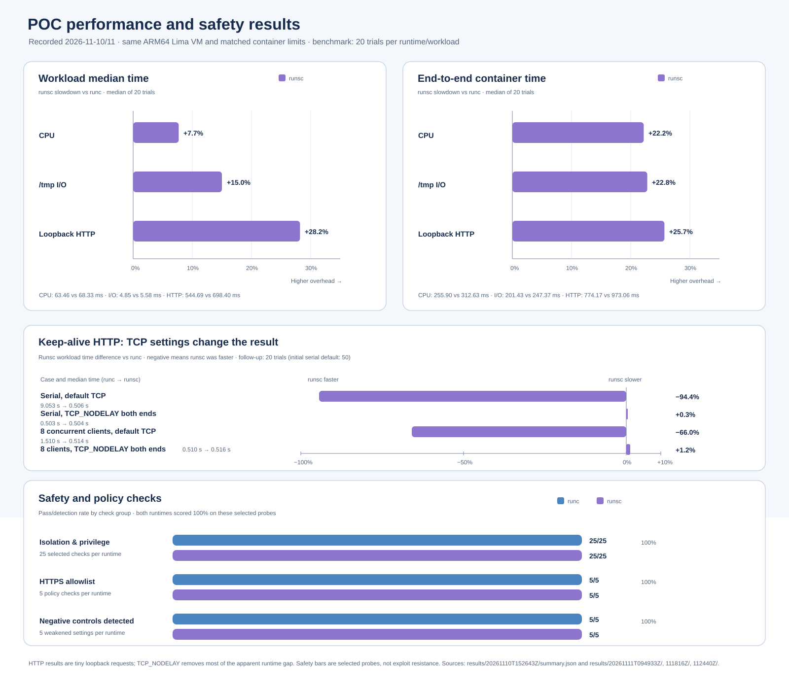
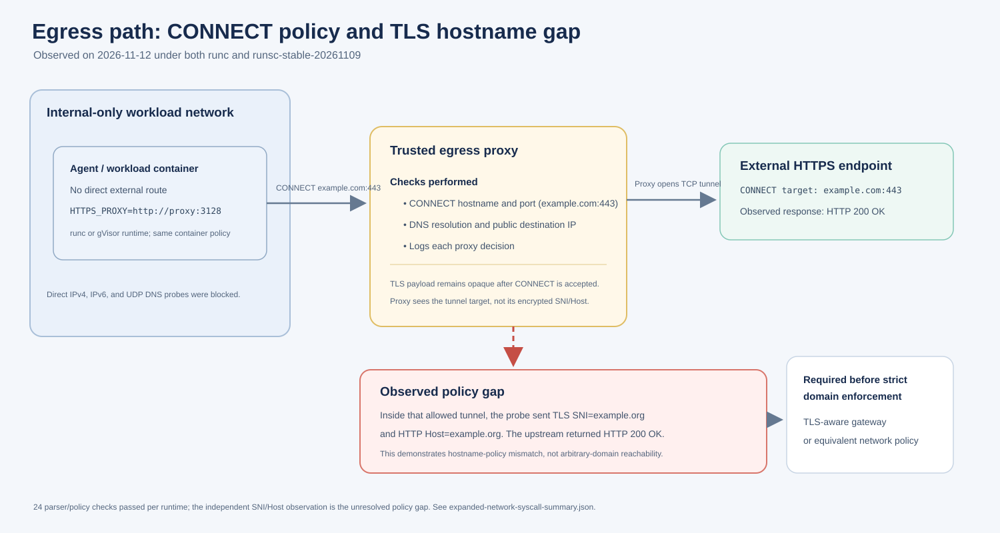

# Local gVisor POC summary

The whiteboard requirements and their evidence-based status are summarized in the [requirements status matrix](../REQUIREMENTS_STATUS.md): 0/4 functional and 0/3 non-functional top-level requirements are fully demonstrated; all 4 functional and 2 non-functional are partial, while uptime remains untested. A [five-session cached-image smoke](../reports/SESSION_READINESS_RESULTS.md) passed 50/50 starts per runtime; full platform readiness remains unmeasured.

1. **Objective:** Compare Docker's default `runc` runtime with gVisor's `runsc` for synthetic performance, runtime compatibility, and selected sandbox policy checks. This POC is an engineering evaluation, not a security certification.
2. **Environment:** Apple Silicon Mac running a dedicated Lima ARM64 Ubuntu VM, Docker Engine 29.9.3, the original pinned gVisor `release-20261102.0`, and a separately registered stable `release-20261109.0` candidate; the POC also retains the previously evaluated `runsc-next` nightly.
3. **Matched container policy:** Both runtime paths use the same image and limits: 1 CPU, 256 MiB RAM, 128 PIDs, non-root UID 10001, all capabilities dropped, `no_new_privileges`, read-only root filesystem, writable 64 MiB `/tmp`, and no network for baseline tests.
4. **Performance method:** The refined benchmark warmed up each runtime/workload pair, alternated runtime order, reversed workload order every other trial, and collected 20 measurements per pair. It reports workload duration and end-to-end `docker run` time.
5. **Performance finding:** The original 20-trial run found `runsc` workload medians 7.7% slower for CPU, 15.0% slower for `/tmp` I/O, and 28.2% slower for fresh-connection HTTP. A later 50-trial keep-alive run showed a 94.4% lower `runsc` time for 200 serial loopback requests, but that gap fell to 0.3% when `TCP_NODELAY` was enabled at both endpoints.
6. **Performance limits:** Results cover one VM and short synthetic workloads. `/tmp` is memory-backed; image pulls/builds are outside the timing. The keep-alive behavior is highly sensitive to TCP settings and uses tiny loopback requests; it does not predict production HTTP or egress performance.
7. **Baseline isolation checks:** Both runtimes passed the reported 25 selected privilege and host-boundary checks. They verified non-root execution, zero effective capabilities, `no_new_privileges`, denied `setuid(0)`, read-only root, private process view, no visible Docker socket or synthetic guest marker, and no external network in the baseline case.
8. **Sudo interpretation:** The minimal image has no `sudo` binary; the workload also failed to gain root via `setuid(0)`. This verifies the configured probe case, not behavior with every possible `sudo` installation.
9. **HTTPS allowlist:** Both runtimes passed 24 CONNECT/parser and egress checks, including allowed `example.com:443`, denied domains/IP literals/ports, and blocked direct egress. A separate tunnel probe exposed a material limitation: CONNECT to `example.com:443` carried TLS SNI and HTTP Host for `example.org` and received `200 OK`. The current proxy enforces CONNECT authority but cannot enforce the encrypted hostname; strict domain isolation is not achieved.
10. **Negative controls:** Ten deliberately weakened cases were detected across both runtimes: root user, added capability, writable root filesystem, synthetic bind mount, and direct bridge egress. A discovered Docker inspect gap for `--mount` was fixed by checking both `HostConfig.Binds` and top-level `Mounts`.
11. **Syscall matrix:** Seven harmless probes were run with Docker's built-in seccomp profile and a hash-pinned derived overlay. Under `runc`, `bpf`, `keyctl`, and `mount` changed from generic `EPERM` to errors consistent with the deliberately invalid requests when allowed through the overlay. `runsc` returned the same outcomes under both profile modes.
12. **Syscall interpretation and verdict:** The errno differences are consistent with Docker seccomp affecting some `runc` calls, while `runsc` handles these probes differently or another unchanged control applies. They do not identify every enforcement layer and do not prove that `runsc` is more secure. Both runtimes passed these selected configuration probes. The initial CPU, I/O, and fresh-connection HTTP timings favored `runc`; keep-alive results were highly sensitive to TCP_NODELAY settings.
13. **Next steps:** The latest stable release passes focused Bubblewrap, boundary, filesystem, DNS, syscall, namespace/mount, ptrace, and authenticated Codex workspace-write checks. First add TLS-aware egress enforcement or an equivalent network policy and rerun tunnel bypass cases; then measure full session readiness and concurrency before deciding whether to promote the stable candidate. Keep conclusions bounded to the tests actually run.

For a concise leadership brief, see [EXECUTIVE_SUMMARY.md](EXECUTIVE_SUMMARY.md). Detailed data, methods, and limitations are in [REPORT.md](../reports/REPORT.md). Setup and commands are in the [root README](../../README.md). The `runsc-trace` procedure has been documented but **has not yet been run**; no new trace evidence is included in the findings above.

The [managed worker](../runbooks/MANAGED_WORKER.md) now adds persistent pilot workspace, lifecycle state, quota, and explicit cleanup/reconciliation. Its 17 synthetic checks and one authenticated persistence check passed. The [Codex TLS guide](../runbooks/CODEX_TLS.md) and [gateway report](../security/TLS_GATEWAY.md) contain the later authentication and hostname-enforcement results. Browser/API integration and full concurrent authenticated readiness remain pending; see the [documentation index](../README.md).
