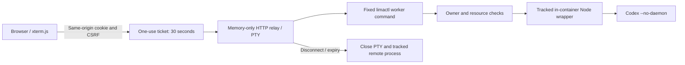

# Local session console

**Status (2026-11-15):** real personal-mode console and loopback API implemented; optional Okta OIDC is simulated-provider tested but awaits real tenant configuration. Create, list, inspect, lifecycle events, stop, and idempotent requests operate the managed Lima worker. Personal mode now includes a browser PTY terminal for private CLI login and Codex attach. The original Mac-terminal handoff remains available as a fallback API; terminal access remains disabled in Okta mode pending its separate acceptance.

## Start

From the repository root on the Mac, with `gvisor-poc` running and the [managed worker](MANAGED_WORKER.md) installed at `~/gvisor-managed-pilot/` inside that VM:

```bash
python3 scripts/serve_session_console.py --port 4180
```

Open **http://127.0.0.1:4180/**. Use that exact address; Host checks intentionally reject alternate hostnames. Keep the server terminal open. Stop the server with Ctrl+C. New sessions receive a one-hour deadline. The backend checks cleanup every 30 seconds, including when the browser page is closed. The resident VM service continues cleanup when this backend closes. VM/Mac suspension or downtime pauses cleanup; overdue sessions are reconciled when the VM service resumes. Existing legacy sessions have no deadline and require manual stop. Use Stop for immediate teardown.

## Workflow

1. Create a session using the fixed approved pilot policy. The backend applies the worker's five-session quota and serialized provisioning.
2. Inspect shows real lifecycle/policy metadata and loads recorded events. Ready means **login-ready**, not authenticated model readiness.
3. Login shows a managed device-login command for Mac Terminal. Complete sign-in privately.
4. Open Codex shows the managed attach command for that same session. Paste it into Mac Terminal; the browser never handles terminal contents, one-time codes, or provider credentials.
5. Stop removes the session, gateway, temporary login home, and networks. The pilot's workspace volume is retained and shared across its sessions.

The console polls worker state and disables create when the worker is unavailable. Overview runtime/resource cards describe fixed policy. The Telemetry section samples current agent CPU, memory and PIDs, with timestamps; session-state filters show active or historical sessions. Review signals cover selected policy drift, sampled egress denials and operational failures. Automated attack detection, central alerts and historical utilization remain pending.

## Local security boundary

The server binds only to 127.0.0.1. API requests use a process-local HttpOnly/SameSite cookie; mutations also require a CSRF token. Host, Origin, and Fetch Metadata checks reject unrelated website origins. Requests accept only the fixed policy, bounded JSON, validated session IDs, and narrowly defined actions. The browser cannot submit Docker flags, worker commands, mounts, images, or shell text. Static file serving is limited to the console assets and Markdown/SVG documentation.

Bootstrap is deliberately available to the local browser: this is not organization authentication. Other processes/users on the same Mac may reach the loopback API, so the machine must have a trusted operator environment. Add real identity/authorization and a reviewed transport before any remote or mutually untrusted multi-user deployment. There is no remote bind option.

No request headers/cookies/bodies are logged. The API forwards only known worker operations to Lima, using argument arrays rather than client-controlled shell commands. It returns sanitized worker metadata/error codes. Browser terminal handoff is specific to this trusted local pilot; it does not implement the future attach-ticket/relay contract.

## Validation

- **12 tests passed:** 11 local HTTP/static boundary tests plus one live worker lifecycle containing eight assertions for create, idempotency, list, inspect, events, terminal handoff, stop, and repeated stop. The live test used a separate synthetic state/volume and removed it afterward.
- Host rebinding, cross-origin/site requests, missing local session/CSRF, policy overrides, invalid IDs, traversal, and unsafe methods were rejected in the tested cases.
- A native terminal launch of the managed attach command displayed Codex 0.167.1 and its sign-in menu, then exited cleanly on Ctrl+C. No login/model request was made during that probe. The earlier automated pseudo-terminal detector did not recognize a screen; the native terminal check confirmed launch.
- A separate console API create/stop used the actual pilot namespace. Diagnostic sessions were stopped; the intended persistent workspace remains.
- JavaScript syntax, DOM IDs, assets, API responses, and documentation links were checked. Browser review subsequently verified live rows, Inspect/close, recorded events, the expiry column, cleanup status, and responsive action visibility. Create/stop remain verified through the HTTP integration tests; they were not graphically exercised against the user’s active session.

Evidence: [API checks](../../results/session-console-20261113/api-checks.json), [terminal launch](../../results/session-console-20261113/terminal-attach.json), and [asset checks](../../results/session-console-20261113/assets.json). Test command:

```bash
POC_LIVE_CONSOLE=1 python3 -m unittest discover -s tests -p test_session_console.py -v
```

The live test provisions synthetic Docker resources. Next validate authenticated interactive attach and VM restart recovery, and complete the decision on organization control-plane integration. Five-session authenticated readiness and service uptime remain unmeasured.

## One-hour expiry follow-up

The user selected one hour for new sessions. Inspect returns `expires` and `stop_reason`; the table displays each deadline and labels expired stops. Idempotent create does not extend a deadline. Expiry removes temporary containers, networks, login homes and gateway keys, while retaining the workspace. A migrated session with a null deadline remains unchanged.

The worker passed [22 checks](../../results/session-expiry-20261113/worker.json), including expiry cleanup, workspace retention and legacy-session preservation. The updated server passed [13 tests](../../results/session-expiry-20261113/api-background.json), including a real synthetic session expired by the background sweeper without any browser request. Tests injected a past timestamp instead of waiting one hour.

The resident VM service now enforces polling independently of the Mac backend; the console sweeper remains a fallback. The UI reports resident active/stale/error status. VM/Mac suspension, downtime, clock changes or cleanup failure can delay expiry; this is not a hard deadline guarantee. See [resident service operations](MANAGED_WORKER.md#resident-cleanup-service).


## Security and observability views (2026-11-13)

The new navigation opens four implemented sections:

- **Policy checks:** Nine selected checks from owned container/network metadata: runtime, non-root user, read-only root, no-new-privileges, nonprivileged/dropped capabilities, resource limits, internal network, workspace/public-CA mount boundary, and gateway hostname configuration. No active session or unavailable metadata displays unmeasured, not passed. These are configuration checks, not a complete security assessment.
- **Telemetry:** Read-only `/api/monitor` samples active agent containers using Docker CPU/memory/PIDs. Monitoring refreshes every 30 seconds; session state refresh remains every eight seconds. Recorded coding timings are loaded separately from checked-in sanitized evidence and labeled as one after-login validation task. No gateway utilization, historical resource chart or uptime SLO is claimed.
- **Suspicious activity / review signals:** Filterable policy drift, bounded gateway deny signals and recent lifecycle failures. They are review indicators, not attribution of an attack; validation traffic can trigger denials. There is no prompt-injection/malware detector or central alert delivery. Live sampled signals are derived on request; the separate resident journal and local alert workflow below retain selected events.
- **Allowed / blocked sites:** Shows the fixed three exact HTTPS hostnames and explains default deny for everything else. The hostname checker performs only a local policy lookup, without DNS/HTTP requests. Policy editing is not exposed. Hostnames of blocked attempts are deliberately not captured; the UI cannot present a per-domain blocked-traffic history.

Gateway sampling reads at most 200 log lines per active gateway from the previous 15 minutes and accepts only known JSON decision/reason fields. Counts represent logged decisions, not unique network requests. Unknown/malformed log entries, URLs, headers, bodies and arbitrary extra fields are discarded. Missing samples and failed monitoring requests are shown as unavailable/stale. This remains a trusted local operator API, not an organizational security dashboard.

Validation: **14 local API tests passed** (one separate live lifecycle test skipped in this batch), **three sanitization/policy tests passed** including seven weakened-configuration cases and unavailable-resource handling, and the real API/worker snapshot passed. Live browser checks verified nine passing checks, current resource data, timing bars, deny-review signals, active/history filters, approved/blocked/lookalike hostname lookups, narrow/desktop navigation and no console errors. No user session was stopped or logged out. [Evidence](../../results/console-monitoring-20261113/).

Next: extend the implemented local journal/alert workflow with explicitly defined suspicious-activity rules, safe policy administration with change review, historical resource collection, and organization identity/authorization. These views do not close the requirements acceptance gaps on their own.


## Durable history and local alerts (2026-11-13)

**Implemented:** Event history, local alert state filters, Acknowledge/Resolve controls, event-type filters, bounded pagination and alert action history. Collection runs in the supervised VM service even with the browser and Mac backend closed. `/api/alerts` and `/api/security-events` read the private worker SQLite journal. Alert mutations use `/api/alerts/{id}/acknowledge` or `/resolve`, with the same loopback session, Origin/CSRF, fixed-body and ID checks as other mutations. Client-supplied actors, notes or arbitrary commands are not accepted.

- Gateway denials are deduplicated by a hash of session, flow ID and policy stage. Re-reading overlapping logs does not increase counts or reopen a resolved alert. Only known decision/reason fields are accepted; raw flow IDs, URLs, bodies, headers and credentials are not stored.
- Lifecycle records use a sequence cursor. Selected policy drift creates one event per failing episode; a verified healthy observation followed by drift starts a new episode. Missing observations do not establish recovery.
- Alerts group by session and signal type. Acknowledge records operator review; Resolve changes review status without remediating policy. A distinct new event reopens a resolved alert. Already-acknowledged alerts remain acknowledged as new evidence increments their count.
- Alert actions record the fixed actor `local-operator`; collector actions record `collector`. This is the trusted local pilot, not an SSO identity or tamper-resistant organizational audit trail. No email, Slack or other external notification is sent.
- The journal retains at most **10,000 events for up to 30 days**, whichever removes records first. Resolved alerts and their action trail are retained for **30 days after resolution**; unresolved alerts remain until reviewed. The original worker lifecycle database and workspace have separate retention behavior. This is not a full database byte quota.
- History requests return at most 100 records using a validated cursor/type filter. The browser displays at most 500 loaded history records before asking the operator to reload newest or narrow the filter. The alert list shows the newest 100 alerts; counters cover all retained alerts.

Collection is polling-based. It samples at most 200 gateway log lines from the last 15 minutes per active session. Fast bursts, stopped/removed gateways before collection, and downtime longer than that window can miss traffic events. Gateway journal timestamps are first-observed collection times, not packet times; lifecycle timestamps come from the worker. The collector shows its last collection time and incomplete sample count. Unavailable/stale collection is not proof of an incident-free period. Historical traffic before this collector was installed is not reconstructed.

**Validation:** Six journal tests and four sanitization/policy tests passed; 16 local API tests passed with one separate live lifecycle test skipped. The journal-enabled resident service passed 11 isolated service checks. A disposable real pilot session generated two rejected CONNECT flows (403, no allowed outbound website request). Resident collection opened an alert, API acknowledgement/resolution succeeded, a new flow reopened it with count two, and service resampling did not duplicate it. Browser acknowledgement/resolution, state/type filters, two retained denial events and six action records were verified with no console errors. Alert state/history survived collector and Mac console restarts. The test session was stopped and workspace retained; its resolved validation alert remains as evidence. [Results](../../results/security-history-20261113/).

Next: define detection thresholds and review criteria, extend signal coverage, add reviewed external delivery if required, and implement organization authorization. These additions do not detect prompt injection or malware and do not close the full security/uptime acceptance gates.


## Versioned review thresholds (2026-11-14)

The Detection rules view now loads `pilot-review-v1` from authenticated read-only `/api/alert-rules`. Seven rules document their priority, trigger and review steps. Four additional signal types cover repeated observed denials, sustained resource pressure, repeated incomplete samples and resumed collection gaps/backwards clocks. Alerts expand current trigger/review guidance, history filters include the new types, and worker-wide collection gaps display as **Worker collector**, not a user session.

Resident collection now samples Docker resource metrics as well as policy/gateway data. Rule progress is durable, duplicate samples do not advance sustained windows, and missing data is not proof of recovery. New evidence records its rule version; pre-metadata rows retain a legacy label. This remains review-only: no automatic session stop, policy change, UI rule editing or external delivery. [Thresholds, limitations, review procedure and test evidence](../security/ALERT_REVIEW_RULES.md).

Validation passed eight rule tests, seven journal tests, four sanitization/policy tests, 17 API tests (one separate live lifecycle test skipped), 11 isolated service checks and eight real burst/cleanup checks. Resource/gap thresholds used injected unit samples; the real network test used five requests rejected by the gateway. The two resulting validation alerts were resolved through the UI; historical evidence was retained.


## Owner-scoped local foundation (2026-11-14)

The console now displays a trusted server-bound principal/role and explicitly marks SSO as disconnected. Default startup remains `local-pilot` operator. An explicit principal defaults to member, with a two-session member limit inside the unchanged five-session worker cap. Request bodies/headers cannot select an owner or role. Sessions, monitoring/history/alerts/audit and mutations are owner-scoped for members. Operator login/attach to another owner's session is denied even though inspection and stop are permitted; the UI disables those credential actions as well.

New principals get separate persistent workspace volumes and fresh temporary homes. Legacy pilot rows, workspace names and deadlines are preserved. These controls were tested with **simulated local principals**, not organization identities. Do not expose these process-bound local consoles to untrusted users: local bootstrap and editable terminal handoff remain trusted-operator facilities. [Permissions, migration and evidence](../security/USER_ISOLATION.md). SSO and a secure user attach channel are the next gates.

## Personal / Okta authentication (2026-11-14)

Use `--auth-mode personal` for the existing trusted loopback console. `--check-auth-config` remains offline and does not establish login readiness. Optional `--auth-mode okta --auth-config <external-public-config.json>` requires optional dependencies, a server-side secret and verified provider discovery before startup. The implemented code/PKCE callback validates signed tokens, creates independent expiring browser sessions and binds each worker request to the assigned identity/role. Bootstrap never grants local authority in that mode. The UI offers Okta sign-in/sign-out; privileged terminal handoff is disabled pending a secure relay. Real tenant login remains unverified. [Commands, tested cases and limitations](../security/AUTHENTICATION.md).


**Current operating decision (2026-11-14):** Okta authentication work is deferred at the user's request. Personal mode has been restored at `http://127.0.0.1:4180`; local-pilot identity, session listing and resident cleanup health passed. OIDC code/configuration are retained, but real login acceptance remains open. Continue the local functionality priorities in the [roadmap](../platform/PLATFORM_ROADMAP.md#active-delivery-priorities-2026-11-14); no remote or untrusted multi-user exposure is enabled.


## Browser terminal for the local personal pilot (2026-11-15)

**Implemented:** Create a session, then choose **Open Codex** or **Login** in its row. The modal embeds a real PTY-backed xterm.js terminal. Keyboard input and resize reach the fixed Codex command inside that session's existing runsc container. Login remains the user's private Codex device flow; platform Okta enrollment/login work is deferred.

**Use:** Reload the local console after a backend update. **New session → Open Codex** shows the CLI, or choose **Login** to start device authorization directly. Enter any private authentication information yourself; keep one-time codes out of chat, screenshots and shared logs. Close/Disconnect ends this attached CLI process, retaining the running sandbox and persistent workspace. Reopen starts a fresh CLI process, not tmux-style process resume. **Stop** removes the sandbox and its temporary login home under the existing policy, retaining its managed workspace.



### Boundary and resource limits

- Personal mode only, `127.0.0.1`; the Okta-mode relay routes return 501. This is a trusted local operator feature, not remote/organization terminal access. Organization rollout still requires verified identity, reviewed HTTPS and additional acceptance.
- Ticket issue requires the existing session cookie, exact-origin boundary and CSRF; tickets are random, stored hashed in memory, expire after 30 seconds and are consumed once. The request selects only `login` or `attach`, with a known session ID; it cannot supply a host command, Docker flags, image, path or environment.
- Owner authorization is checked at issue, consume and worker launch, including denying foreign attach to an operator. Tickets and handles bind to principal and a dedicated HttpOnly browser cookie. Concurrent connection reservations allow at most five channels and one per sandbox; pending tickets are capped at 32.
- Browser cookies use the local port in their name, preventing accidental cookie overwrites between the main console and an isolated preview. This is not protection from malicious processes/servers on a trusted local host: HTTP cookies are not intrinsically port-isolated.
- The relay polls output every 200 ms, with at most 32 KiB per response and a 256 KiB memory buffer per channel. Input is at most 4 KiB per request and the UI queues at most 64 KiB. An output overrun closes the channel rather than silently replaying/dropping an unknown screen. Grid limits are 20–300 columns and 5–120 rows.
- A controlling PTY is acquired in an exec'd helper, avoiding a threaded-process preexec hook. Child environment is restricted to terminal/host routing essentials and does not inherit provider API keys or the Okta client secret. A fixed SSH wrapper disables local escape characters/command mode, local commands, agent/X11 forwarding and new forwardings, so typed terminal input cannot become an SSH host-control command. The worker runs only the existing fixed Codex foreground commands inside its unchanged container policy.
- Explicit close shuts input immediately and reaps the host child plus a tracked container wrapper/CLI. The remote cleanup checks PID start time and relay arguments before signalling. A temporary cancellation marker also blocks delayed startup after an immediate disconnect. These markers remain in the sandbox's ephemeral `/tmp` until sandbox removal; they contain no credentials.
- No output polling for 30 seconds or the known session deadline closes the channel. Session state is checked periodically, and a successful Stop revokes its tickets/channels. Host/VM suspension or an unavailable worker can delay remote teardown; failed cleanup retains capacity and retries, rather than declaring success or allowing overlapping attach. Stopping the sandbox is the recovery path if worker cleanup cannot complete.
- Terminal bytes, tokens and input are not written to server logs, SQLite or files. Output lives briefly in bounded relay memory and the browser scrollback; closing the panel disposes the browser terminal. Normal attach/login and terminal-closed metadata go to worker lifecycle events; a durable ticket-issue/use audit journal remains future work.
- Vendored xterm.js 6.0.0 and fit addon 0.11.0 use pinned official npm tarballs, recorded integrity/file hashes and retained MIT licenses in `ui/console/vendor/manifest.json`. No runtime CDN or package scripts. Terminal output is untrusted: no HTML insertion, title application, clipboard addon or active links. Only the terminal page permits inline renderer styles; scripts remain self-only and the dashboard keeps its stricter style/frame-ancestor policy.

### API and files

| Route | Purpose |
|---|---|
| `POST /api/sessions/{id}/terminal-ticket` | Owner-authorized ticket for fixed login/attach mode |
| `POST /api/terminals` | Consume ticket once and create PTY channel |
| `GET /api/terminals/{handle}?cursor=N` | Bound output polling |
| `POST /api/terminals/{handle}/input` | Bounded base64 terminal bytes, never a host command |
| `POST /api/terminals/{handle}/resize` | Validate/update grid size |
| `POST /api/terminals/{handle}/close` | Disconnect and start cleanup |

`serve_session_console.py` applies HTTP/cookie/CSRF boundaries; `terminal_relay.py` owns tickets, PTYs, buffers and teardown; `terminal_exec.py` acquires the controlling TTY and `terminal_ssh.sh` fixes SSH transport restrictions; `manage_codex_session.py` enforces owner/container labels; `terminal_programs.py` tracks and closes the fixed in-container CLI; `ui/console/terminal.*` renders private terminal I/O.

[Validation evidence](../../results/browser-terminal-20261115/) includes synthetic authorization/real host PTY/HTTP cases, the existing console and ownership regressions, and deferred OIDC regressions. An isolated real runsc sandbox rendered Codex's sign-in UI, accepted resize, reaped terminal processes on explicit and immediate disconnect, retained workspace data after disconnect, revoked a channel on Stop, retained the volume and removed only disposable test resources. Browser review exercised Create → Open Codex, arrow-key navigation, Disconnect, panel close and Stop with no console errors. An injected relay deadline tests expiry without waiting one hour.

The initial terminal implementation batch did not establish actual Codex login, a model task, five-terminal concurrency performance, real SSO relay access, sustained uptime or remote deployment. Isolated preview states have no dedicated resident collector, so their health banner correctly reports fallback cleanup; the real pilot's resident service is checked separately. The authenticated follow-up below closes one local browser workflow check; workspace lifecycle controls and performance/soak gates remain next.

### Authenticated browser workflow follow-up (2026-11-15)

Private browser login and a real Codex coding task passed in the existing hardened personal-mode session. The task created two dependency-free Node files in a new acceptance-only workspace subfolder: eight generated tests and 11 independent edge-case assertions passed. Disconnect ended the attached Codex process; reopening started a fresh authenticated CLI and retained identical file hashes. Both test sessions were stopped through the UI; container/network removal and retained workspace hashes were independently verified with a temporary read-only, network-disabled probe. The temporary login home was a container tmpfs and disappeared with container removal. No credential files were inspected or copied.

This demonstrates one local authenticated workflow, not process-resume semantics, five-terminal concurrency, readiness p95, uptime, real Okta or remote/multi-user acceptance. Synthetic test files remain in the persistent workspace as intended. [Sanitized result](../../results/browser-acceptance-20261115/status.json), [independent checks](../../results/browser-acceptance-20261115/independent.json), [disconnect](../../results/browser-acceptance-20261115/disconnect.json), [reconnect](../../results/browser-acceptance-20261115/reconnect.json), [cleanup](../../results/browser-acceptance-20261115/cleanup.json).


## Workspace storage visibility (2026-11-15)

Open **Workspace storage** in the personal console. It shows the authenticated owner's retained workspace, allocated bytes, active-session count and a **5 GiB per-user limit** (enforced for the migrated pilot; advisory for unenrolled legacy volumes). Stop/expiry retains workspace data; temporary login homes are excluded. Refresh runs on initial load and on request, not with periodic telemetry.

`GET /api/workspace` uses the existing authenticated console boundary and the worker's bound principal. It accepts no query parameters or caller-selected owner, volume or path; POST returns 405. `manage_codex_session.py workspace` exposes the same metadata. The response includes `allocated_bytes`, `measurement_status`, `budget_bytes`, nullable `over_budget`, `active_sessions`, retention and sample time. It returns no filenames, contents or host mount paths.

The worker checks resource ownership and accepts the expected ordinary local volume or an explicitly enrolled, root-verified quota binding. Arbitrary custom mount options remain rejected. A temporary pinned-image/runsc probe runs `du -sk /workspace` directly as UID 10001 with a read-only volume/root, no network, dropped capabilities, no new privileges, 1 CPU, 128 MiB and 32 PIDs. The Docker call has a 30-second timeout; cleanup removes the probe even after failure. Missing workspaces are not created. An unreadable/failed/incomplete scan reports unknown, never zero; a remaining probe raises a cleanup error.

This is allocated usage rounded to KiB, readable by the sandbox user, and a live non-atomic sample. **Legacy volumes remain advisory:** `hard_quota_enforced=false` and `quota_bytes=null`. Enrolled quota-backed storage reports verified hard-limit/used/remaining fields described below. Exceeding the budget flags the sample; it does not block writes or launches. Bounded owner-only export is now implemented (below); owner-confirmed deletion is implemented below; retention automation remains pending; the actual pilot migration is complete with its original retained for rollback.

**Validation:** 51 regression tests passed with one opt-in live test skipped; eight isolated real-VM checks passed, including unchanged content, unreadable-data handling and probe cleanup. The deployed endpoint and browser refresh measured the retained local workspace at 22,528 bytes with zero active sessions and no browser errors. An initial Node child-process launcher failed with ENOMEM; running `du` directly passed at the original 128 MiB limit. [Live evidence](../../results/workspace-storage-20261115/live.json), [regressions](../../results/workspace-storage-20261115/regressions.json), [deployed sample](../../results/workspace-storage-20261115/deployed.json).


## Owner-only workspace export (2026-11-15)

In **Workspace storage**, choose **Download workspace archive** after stopping all sessions that use your workspace. This downloads `workspace.tar` through the local console, without deleting or changing workspace data. The archive can contain sensitive project files; keep it private. Temporary session homes and their Codex credentials are outside the mounted workspace and are not included. Files a user has themselves stored in `/workspace` are included; there is no secret scanner or redaction.

`POST /api/workspace/export` accepts exactly `{}` with the existing authenticated cookie, same-origin and CSRF boundary. GET returns 405; owner/path/query fields are rejected. The worker command is `export-workspace`, bound to the server-selected principal; even an operator cannot select another owner's workspace through this endpoint. Active database sessions or running containers using the volume return `409 workspace_in_use`; a missing workspace returns 404.

The worker holds its lifecycle lock throughout the export, preventing managed create/stop races. It validates the same volume ownership/local-driver boundaries as usage reporting and runs pinned-image `tar` directly under runsc, UID 10001, no network, read-only volume/root, dropped capabilities and no new privileges, with 1 CPU / 128 MiB / 32 PIDs. The archive is bounded to **16 MiB, 10,000 entries and a 30-second capture**. Private stderr is discarded; failed, oversized, unreadable, unsupported or unsafe exports return no partial download. Probe removal runs on all outcomes and incomplete cleanup is an error.

Only regular files/directories with safe relative portable paths are accepted. Symlinks, hard links, devices/FIFOs, traversal/absolute paths, backslashes, colons and control characters are rejected. USTAR format also imposes name-length limitations. No archive is extracted onto the worker or Mac by the service; the browser receives a fixed attachment filename with no-store/nosniff headers. Archives pass through bounded memory, with base64 used only on the local worker JSON transport; the service does not retain an export file. This is a conservative small-workspace pilot: the advisory 5 GiB budget is **not** the export size limit. Larger workspaces require a separately designed bounded streaming/export backend.

The lifecycle lock protects managed operations, not a trusted host administrator modifying the volume directly. Export is not a backup/restore or consistent live-snapshot service. Existing hard links/symlinks must be removed or handled by a future explicitly reviewed export design. Owner-confirmed deletion is implemented below; actual-pilot migration is complete with its original retained; automated retention remains pending.

**Validation:** 61 tests passed and one opt-in live lifecycle test skipped across export, storage, console, ownership and terminal regression suites; nine export unit cases include real subprocess size/timeout checks. Seven isolated gVisor checks passed for fixture contents, unchanged files, symlink rejection, active-session rejection and cleanup. The browser downloaded a separate synthetic fixture archive; contents were verified without extracting, then the test archive, volume/state and temporary console were removed. Your actual workspace was not exported during validation. No browser console errors or remaining export probe containers were observed. [Regression evidence](../../results/workspace-export-20261115/regressions.json), [live evidence](../../results/workspace-export-20261115/live.json), [browser cleanup](../../results/workspace-export-20261115/browser.json).


## Owner-confirmed workspace deletion (2026-11-15)

Choose **Delete workspace…** in Workspace storage. The dialog names the owner, states that deletion is permanent, and requires typing exactly **DELETE WORKSPACE** before enabling the final action. Cancel closes the dialog without deleting data. Export first if you need a copy; there is no automatic backup or undo. Stop all sessions first. Running or stopped container references also block deletion; the service never forces their removal. A future session creates a new empty workspace. Session records and audit history remain.

The API uses two authenticated, same-origin, CSRF-protected POST operations:

- `/api/workspace/deletion-prepare` accepts exactly `{}` and returns a random 60-second confirmation token bound to the authenticated owner and current managed volume identity. Preparing again invalidates that owner's earlier token.
- `/api/workspace/delete` accepts exactly `token` and `confirmation` (`DELETE WORKSPACE`). It accepts no caller-selected owner, path or volume; GET and query fields are rejected. Invalid/expired/replayed consent, changed workspaces and in-use workspaces return 409.

Worker commands `prepare-workspace-deletion` and `delete-workspace` share the same authorization/consent checks. The existing worker lifecycle lock spans identity checks, idle checks, consent consumption, audit and Docker removal, excluding managed create/stop races. Identity includes volume name, creation time, labels, local driver and options. Foreign-owner labels and arbitrary bind-backed/custom volumes are rejected; enrolled quota bindings must pass the root-owned backend verification. The final idle/lifetime checks are repeated at deletion time. Trusted host-administrator changes are outside the worker lock.

An additive `workspace_deletions` SQLite table stores token hashes, owner, volume fingerprint, deadline and used time; raw tokens are returned only to the requesting client. The token is consumed atomically with a durable `requested` audit before Docker removal. Failure to commit that audit prevents removal. The ordinary-volume branch runs `docker volume rm` without force and confirms absence using a successful Docker volume listing. The quota branch requires verified deletion of the backing image/filesystem as well as volume metadata. Outcomes are `deleted`, `failed` or `unknown`; an interrupted process may leave `requested`. Uncertain outcomes are not reported as success and tokens cannot be replayed after an attempted removal. Inspect storage/audit before preparing new consent.

The last ten deletion attempts for the current actor appear in workspace metadata/UI as outcome and time. Audit records contain actor, action, managed-volume identifier and time, not filenames, file contents or confirmation tokens. Audit retention/export is a separate pending policy. Cancel discards the browser token; its server-side hash expires within 60 seconds or is invalidated by a new preparation. Volume removal is logical deletion, not a secure-erasure guarantee for host backups/storage.

**Validation:** 74 tests passed with one opt-in live lifecycle test skipped. Twelve deletion cases cover ownership, explicit consent, expiry before/after Docker checks, replay, changed identity, active sessions/container references, unknown outcomes, audit-write failure, and CLI JSON error handling. Eight real-VM checks passed using only a fresh disposable volume. Browser checks verified initially disabled confirmation, partial/exact phrases and cancellation; the final delete button was not clicked during browser testing. Separate authenticated HTTP requests deleted only the disposable fixture and verified audit/absence/replay. An initial replay check exposed a CLI exception-class identity bug; a failing real-CLI test reproduced it, the module alias fixed it, and HTTP replay now returns 409. The temporary console, fixture volume and state were removed. The actual personal workspace remains retained with no deletion audit. [Regressions](../../results/workspace-deletion-20261115/regressions.json), [live](../../results/workspace-deletion-20261115/live.json), [HTTP/browser](../../results/workspace-deletion-20261115/http-browser.json), [actual workspace](../../results/workspace-deletion-20261115/personal-workspace.json), [corrected failure](../../results/workspace-deletion-20261115/initial-http-failure.json).

Actual-pilot migration is complete; acceptance/finalization of its retained rollback copy, automated retention, large-workspace export, real organization acceptance and sustained availability gates remain open.


## Opt-in managed quotas (2026-11-15)

The [managed 5 GiB quota backend](../platform/WORKSPACE_QUOTAS.md) is implemented and deployed for trusted-operator-enrolled owners. Its root-owned helper/service validates filesystem identity, actual mount/quota settings and ownership before workspace operations. A 22-check managed canary passed two-session aggregate quota, cross-owner denial, changed-limit/missing-mount refusal, readonly export, expiry retention, mount-service recovery and actual backing-data deletion. 106 affected regression tests passed with one opt-in live test skipped. A temporary browser panel showed the verified hard limit and remaining space with no console errors.

Enrollment uses private `quota-owners.json` in the registered worker state; it is not an end-user UI action. See the backend runbook before enrollment. Existing ordinary workspaces require a separate verified migration/cutover and cannot be converted by merely setting the flag. **Update (2026-11-16): The actual local-pilot workspace is migrated and has an enforced 5 GiB quota.** Its original volume remains retained for rollback. A 16-check migration canary, repeat 22-check quota canary and 123 tests (one skipped) passed. The UI verifies the quota and refuses permanent deletion while the rollback copy is retained. See [migration/recovery commands](WORKSPACE_MIGRATION.md). No model requests or temporary authentication-home access were needed. Full VM reboot and sustained availability remain pending.
